<h1 align="center">CodeGPT</h1>

<p align="center">让 ChatGPT 按授权范围，检索和阅读你本地项目的当前代码。</p>

<p align="center">
  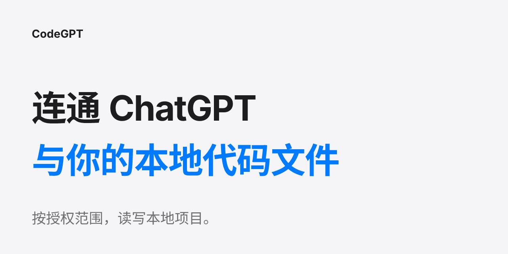
</p>

CodeGPT 把本地项目接入 ChatGPT，让你在对话中查找文件、理解实现、查看 Git 改动。它在你的电脑上运行，按登记的项目和权限提供当前代码；连接和项目通过本机配置页管理，默认只读，需要写入时再单独授权。

**模型负责思考，MCP 提供事实，用户掌握决策。** 原始文件留在本机；工具返回的代码片段会传给所连接的模型服务端。

**19 工具版发布预览：** 版本范围为 15 个 Core 工具，加 4 个 Codex CLI 业务工具。当前安装包可运行的默认入口仍是 Core 15；新增四工具的统一接入正在完成，尚未作为可执行能力发布。以下逐项区分已可用与待接线。

## 本页导航

[能做什么](#capabilities) · [配置页面](#interface) · [工作流程](#workflow) · [系统架构与技术栈](#architecture) · [快速开始](#quick-start) · [连接 ChatGPT](#connect) · [权限与配置](#permissions) · [故障恢复](#recovery) · [验证与限制](#limits) · [许可与资源](#resources)

<a name="capabilities"></a>
## 能做什么

适合需要在对话中理解多个本地仓库、检查当前改动或整理项目文档的开发者。它不预先上传整仓，不建立代码索引数据库；模型问到哪里，工具读取到哪里。

| 你遇到的问题 | 在 CodeGPT 中操作 | 得到的结果 |
|---|---|---|
| 不知道该从哪个仓库、文件入手 | 登记项目，列目录，批量读取或按行深读 | 当前项目清单、目录树、文件片段与 SHA-256 |
| 想找一段实现及相关改动 | 用 ripgrep 搜索，再查看 Git 状态与差异 | 文件路径、行号、命中文本和版本事实 |
| 想追踪定义、引用或诊断 | 在有工程标记和语言服务器的项目调用 LSP 工具 | 定义位置、引用、符号、诊断及重命名预览；不可用时明确提示 |
| 希望 AI 落地文档或文件 | 单独开启某项目受控写，提供必要文件哈希 | 校验后的文本、二进制文档或工作区编辑；冲突时拒绝覆盖 |
| 不想手工改配置、猜连接状态 | 在本机 Setup 保存项目，查看四层连接状态 | 真正生效的 TOML 配置，以及探测延迟、近期断连与 MCP 活动 |

### 19 个工具的版本范围

已可用的 15 个 Core 工具：

| 场景 | 工具 | 关键行为 |
|---|---|---|
| 发现项目 | `list_projects`、`project_info` | 只显示注册项目及项目事实 |
| 浏览与读取 | `list_files`、`read_file`、`read_batch` | 支持目录、行区间、批量读取和字符预算 |
| 搜索与版本 | `search_code`、`git_info` | 搜索由 ripgrep 执行；非 Git 目录明确降级 |
| 代码语义（可选 LSP） | `find_definition`、`find_references`、`workspace_symbols`、`get_diagnostics`、`rename_preview` | 依赖对应语言服务器和工程上下文，不可用不会假报成功 |
| 受控写（默认关闭） | `write_file`、`write_binary_file`、`apply_workspace_edit` | 服务端检查项目权限、路径、敏感文件、内容哈希与写入预算 |

Core 不需要安装或登录 Codex。可选 Agent 默认为 OFF；其设置页面不代表自动阅读或远程执行已经通过验收。

新增的 4 个 Codex CLI 业务工具：

| 工具 | 完成接入后的用途 | 当前状态 |
|---|---|---|
| `project_context` | 请求项目概览、回答代码问题或复用已有报告 | 任务服务接口已实现；默认 MCP 尚未注册，真实 Worker 执行保持拒绝 |
| `local_task` | 向本机代理提交受授权的任务 | 待实现与接线；当前安装包不提供此工具 |
| `task_poll` | 查询已接受任务和分页读取持久报告 | 服务与存储接口已实现；默认 MCP 尚未注册 |
| `task_cancel` | 取消自有任务并清理所属原生进程 | 服务接口已实现；默认 MCP 尚未注册 |

`auth_test_ping` 是独立认证实验的诊断工具，不计入这 19 个业务工具。Codex CLI 四工具完成后需要单独验证真实任务链；本预览不触发模型、不开放匿名远程 Agent 执行。

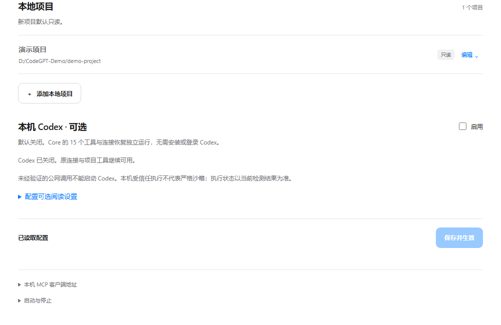

这是独立环境中实际运行的配置页。下面展开它的主要操作区域；GitHub 上的图片和展示页不会连接你的电脑或保存凭据。

<a name="interface"></a>
## 配置页面

连接、项目和状态集中在同一个本机页面，不需要来回切换管理后台。以下截图使用合成只读项目，公网隧道和 Agent 均未启用。

### 配置公网连接

先选择连接通道，再跟着页面注册 ngrok、复制 authtoken、粘贴并启用。已有固定开发域名可在高级连接设置填写；Cloudflare 临时连接和本机直连也保留为备选。凭据只保存在本机，不会回显到页面。

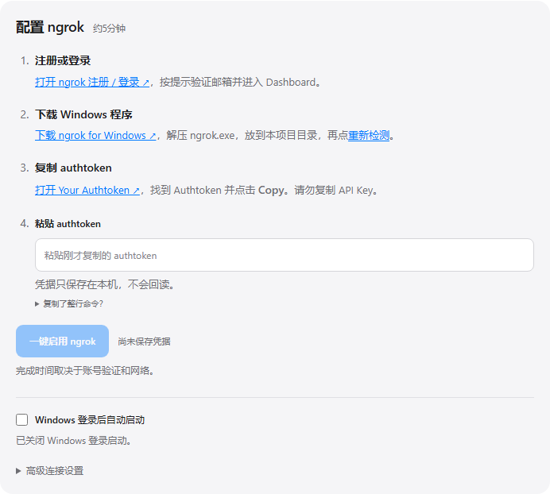

### 接入 ChatGPT

公网地址验证通过后复制到 ChatGPT，按页面指引创建连接，再调用 `list_projects` 验证。仅本机在线时，ChatGPT 网页仍无法访问 `127.0.0.1`；截图中的空地址表示尚未启用公网连接。

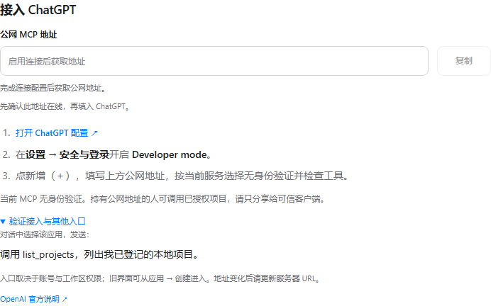

### 查看连接状态

分别查看 Local MCP、Tunnel、Public URL 和实际 MCP 调用，定位故障发生在哪一层。最近五分钟视图来自真实探测采样；本次截图中本机 MCP 在线，隧道未启用，公网地址未配置，并记录了实际只读调用。

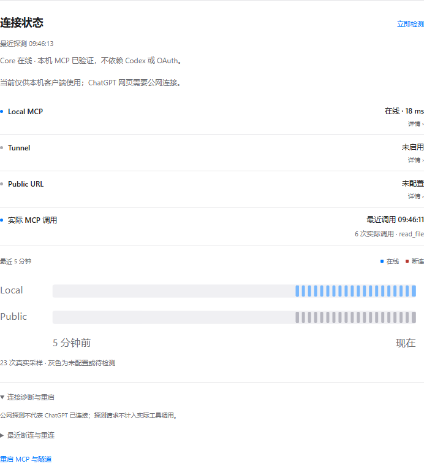

### 编辑项目与权限

展开项目，填写名称、唯一 ID 和已有目录，选择只读或受控写，再保存并确认生效。移除只取消登记，不删除文件；写权限须单独开启，工作区重命名的范围限制见下方权限说明。

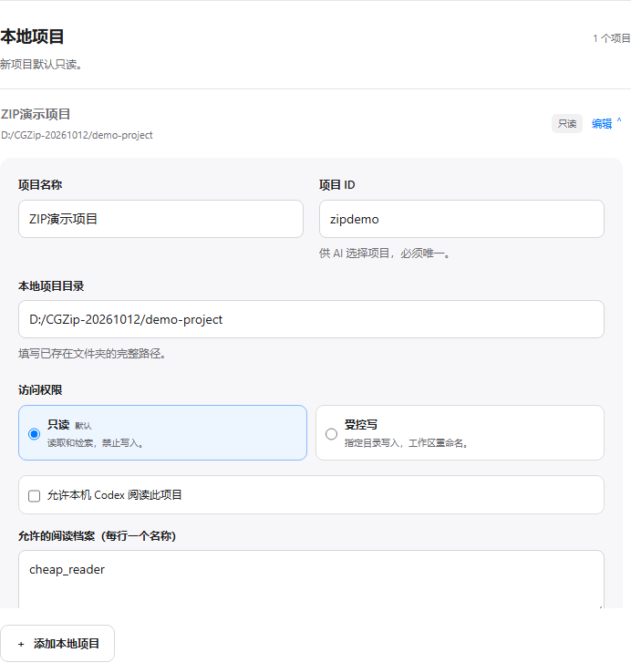

### 配置可选 Codex

可查看套餐或自备 API 的额度来源、阅读档案、模型 ID 和推理强度等选项。Agent 默认关闭，Core 可独立运行；设置界面已提供，真实 Codex 自动阅读仍待接线与验收，截图没有启用或调用模型。

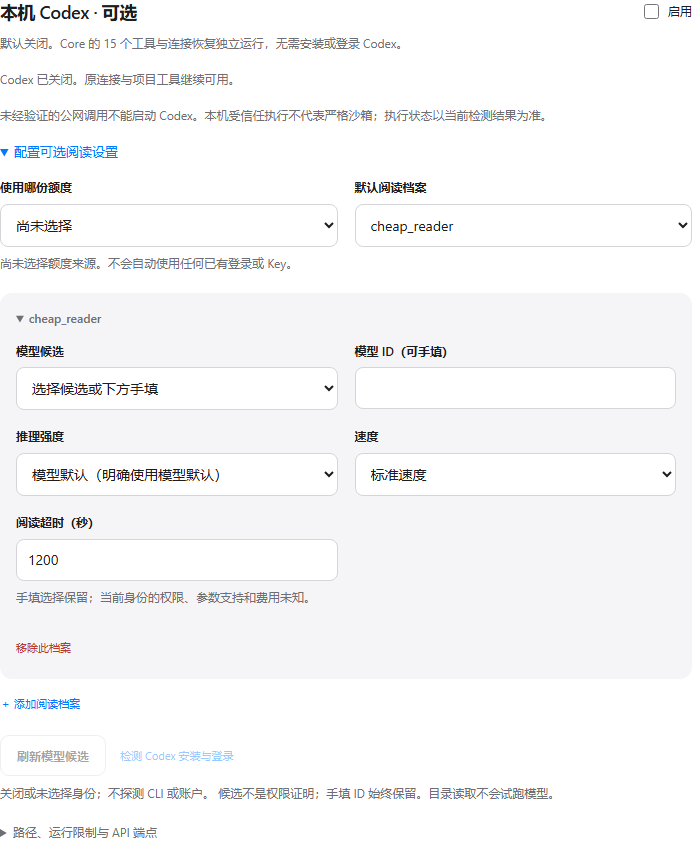

<a name="workflow"></a>
## 工作流程

一次完整使用：**启动本机 Setup → 添加已有项目目录 → 保存并确认生效 → 客户端调用 MCP → 按需获得当前源码。** 对 ChatGPT 网页使用，还需配置公网隧道；本机客户端可直接连接回环地址。

### 保存成功时

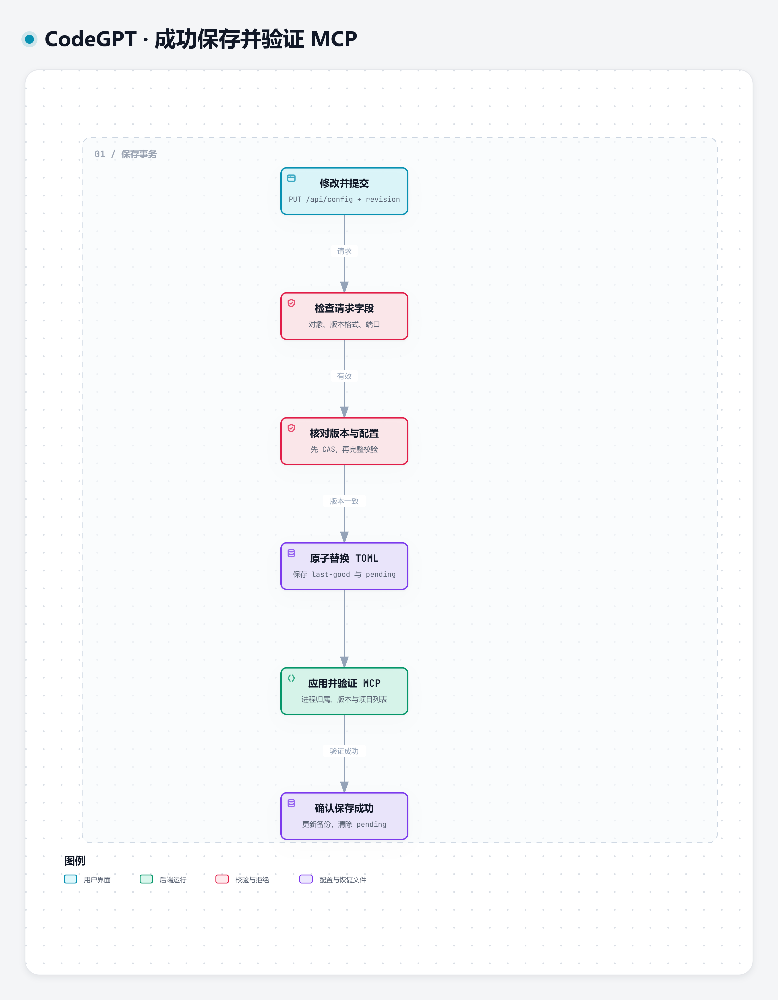

页面提交当前配置 revision 和修改内容。后端先检查并发版本与完整配置，再原子写入唯一的 `config.toml`。项目、权限等变更热生效；需要重启的设置由同一 Runtime 受控处理。后端核对实际加载版本、MCP initialize 和项目清单后，页面才显示成功。

### 冲突或失败时

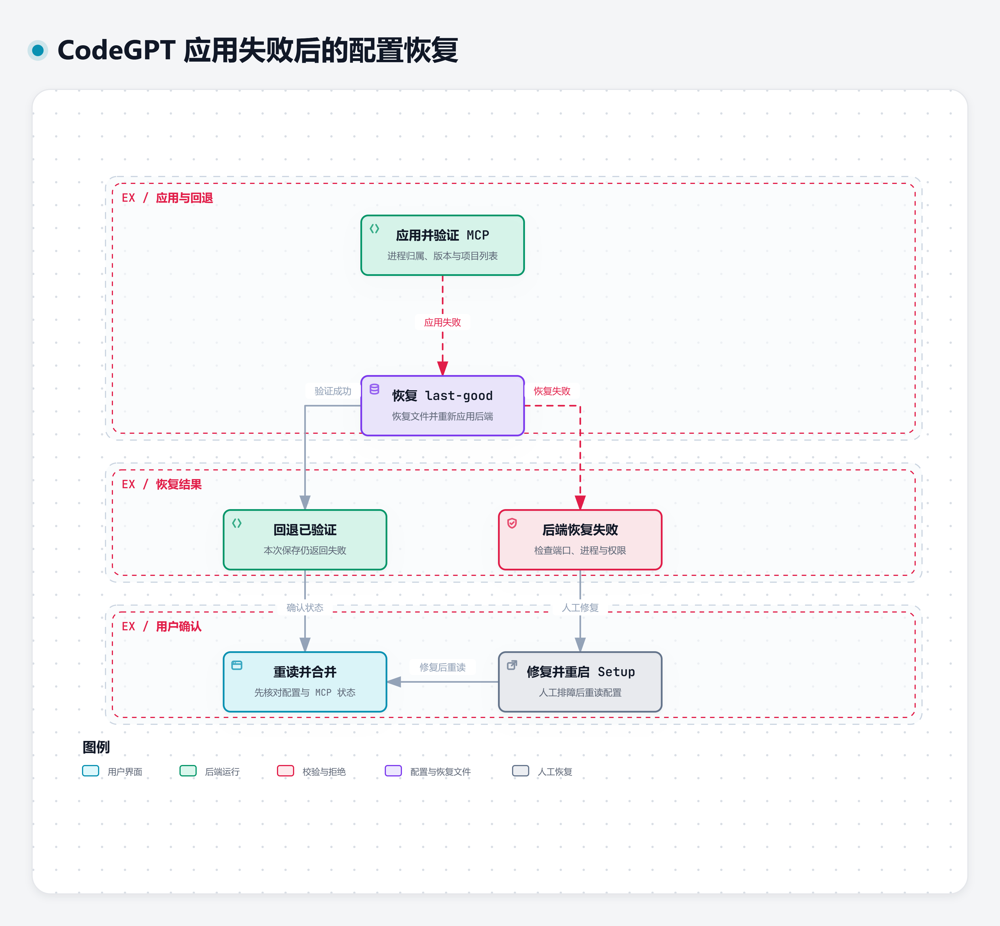

三个失败分支也有明确结果：无效路径或配置保留原设置；并发冲突要求重新读取并合并；应用失败恢复 last-good 并再次验证。若恢复仍失败，页面显示修复建议，不能把“写入过 TOML”当成成功。

[交互成功场景](site/diagrams/configuration-save-success.html) · [成功场景 JSON](assets/configuration-save-success.json) · [成功场景 SVG](assets/configuration-save-success.svg) · [交互恢复场景](site/diagrams/configuration-recovery.html) · [恢复场景 JSON](assets/configuration-recovery.json) · [恢复场景 SVG](assets/configuration-recovery.svg)。下载 HTML 后可以离线打开。

<details>
<summary>展开完整配置事务与全部失败分支</summary>

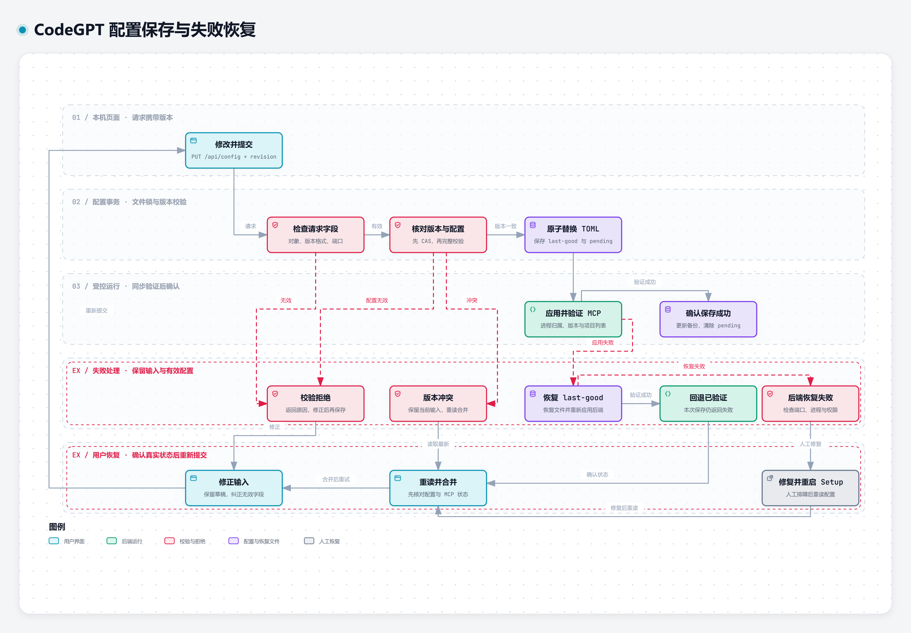

完整图保留全部决策、成功和失败路径。上面两张图用于阅读具体场景；它们不会替代完整事务。

</details>

[交互查看完整流程](https://shltbro.github.io/CodeGPT/diagrams/configuration-workflow.html) · [离线 HTML](site/diagrams/configuration-workflow.html) · [可编辑 JSON](assets/configuration-workflow.json) · [矢量预览](assets/configuration-workflow.svg)。交互版可点击节点、搜索、聚焦路径、切换明暗主题和导出；本页静态图已保留必要分支。

<a name="architecture"></a>
## 系统架构与技术栈

### 系统边界

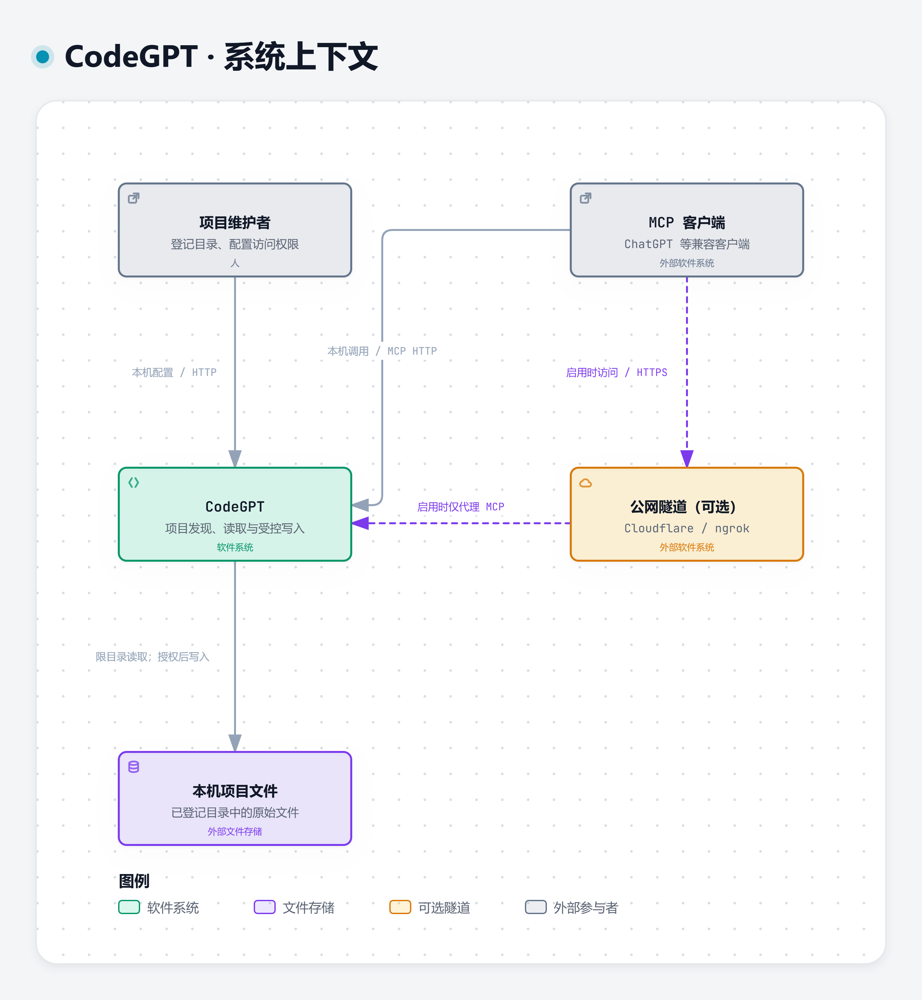

CodeGPT 运行在用户电脑上。用户通过本机 Setup 管理授权范围；本机 MCP 客户端可直连，ChatGPT 云端需要 ngrok 或 Cloudflare 转发。文件内容返回客户端时才会离开本机，隧道不会为访问者提供身份认证。

### 进程与数据

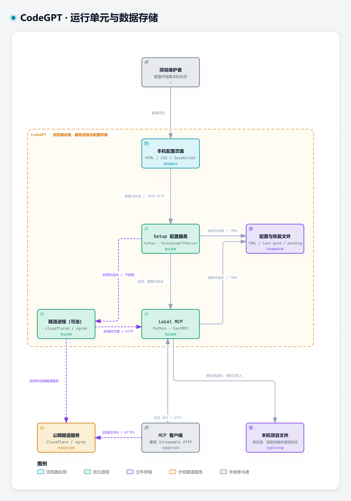

Setup 是独立 localhost 控制面，Runtime 在该进程内管理 MCP 和 Tunnel 子进程。FastMCP 注册 15 个工具；项目注册表、路径与敏感文件检查约束工具访问，读取工具返回文件事实，写入工具另做锁内预检。`config.toml`、last-good 和 `.setup` 是本机文件状态，不是额外数据库或微服务。

图中聚焦核心运行单元；Git、ripgrep 和语言服务器是 MCP 按需调用的工具进程，职责在下表展开。

| 技术 | 在项目里承担什么 |
|---|---|
| Python 3.12+、FastMCP 4.0.5 | 实现工具、Streamable HTTP MCP 入口与客户端验证 |
| Python 标准库 HTTP、HTML/CSS/JavaScript | 提供本机 Setup API 和轻量配置页，无前端构建服务 |
| TOML、`tomllib`、原子文件替换 | 唯一用户配置；revision 检查、last-good、失败恢复 |
| ripgrep、Git | 搜索源码、查询版本状态；作为受控 argv 子进程执行 |
| LSP、Pyright | 按项目标记探测语言能力；Pyright 及其 Node 运行时安装在项目环境 |
| ngrok、cloudflared（按需安装） | 向云端提供 MCP 公网地址，只转发 MCP 端口 |
| pytest、Playwright（开发依赖） | 验证配置、安全边界及真实浏览器保存到 MCP 的联调 |

[交互系统边界 HTML](site/diagrams/architecture-context.html) · [交互进程视图 HTML](site/diagrams/architecture-containers.html)，下载后可直接用浏览器离线打开。可编辑原生 C4 源：[Context](assets/architecture-context.mmd)、[Container](assets/architecture-containers.mmd)；对应 [Context SVG](assets/architecture-context-mermaid.svg) 与 [Container SVG](assets/architecture-containers-mermaid.svg)。交互图另保留 [Context JSON](assets/architecture-context.json)、[Container JSON](assets/architecture-containers.json)，以及 [Context 矢量预览](assets/architecture-context.svg)、[Container 矢量预览](assets/architecture-containers.svg)。

<a name="quick-start"></a>
## 快速开始

可下载 [19 工具版预览源码包](https://github.com/SHlTbro/CodeGPT/archive/refs/tags/codegpt-v1.2.0-codex-preview-20261012.zip)，解压后进入其中的 `local-codebase-mcp` 目录。预览包目前运行 Core 15；需要四个新增业务工具时，等待同范围的完成版本，不把接口目标当作已实现功能。

**已验证 Windows；需要 Python 3.12+ 与首次依赖下载的网络连接。** 建议使用短目录。Git 仅在克隆或查看版本时需要；`search_code` 还需要在 PATH 中可用的 ripgrep。语言服务器按实际项目需要配置，未安装 Codex 不影响 Core。

需要搜索时，从 [ripgrep 官方发行页](https://github.com/BurntSushi/ripgrep/releases) 获取 Windows 包，将包含 `rg.exe` 的目录加入 PATH；在启动 CodeGPT 的终端先运行 `rg --version` 确认。首次项目发现与文件读取不依赖 ripgrep。

### 1. 获取并启动

在 PowerShell 执行：

```powershell
git clone https://github.com/SHlTbro/CodeGPT.git D:\CodeGPT
cd D:\CodeGPT\local-codebase-mcp
.\setup.bat
```

也可下载 [源码 ZIP](https://github.com/SHlTbro/CodeGPT/archive/refs/heads/main.zip)，解压后进入 `local-codebase-mcp` 双击 `setup.bat`。不要把目录放进已有项目的授权范围。

启动器创建该目录的 `.venv`、安装运行依赖，然后打开 `http://127.0.0.1:8169/`。首次配置为空项目、Tunnel OFF、Agent OFF。使用期间保留启动器窗口。

| 入口 | 用途 |
|---|---|
| `setup.bat` | 配置页、MCP 与统一生命周期 |
| `deploy.bat` | 兼容已有部署调用，复用同一个 Setup |
| `stop-all.bat` | 受控停止默认实例；独立端口实例关闭自己的启动器窗口 |
| 页面“Windows 登录后自动启动” | 可选、默认关闭；当前用户登录后启动，不是系统服务 |

### 2. 添加一个只读测试项目

先创建不含私密内容的小目录；如果已有同名目录，换一个新路径，不覆盖现有项目：

```powershell
New-Item -ItemType Directory -Path D:\CodeGPT-Example
Set-Content -LiteralPath D:\CodeGPT-Example\README.md -Value 'CodeGPT first read' -Encoding utf8
```

在 Setup 选择添加项目，填写名称 `My Project`、ID `my-project`、目录 `D:/CodeGPT-Example`，保持“只读”，点击“保存并生效”。等待成功提示，并检查项目出现在页面中。

### 3. 获取第一个真实结果

将本机 MCP 客户端连接到 `http://127.0.0.1:8168/mcp`。**ChatGPT 网页不能使用这个回环地址**，网页接入按照下一节配置公网连接。

请求客户端实际调用 `list_projects`（参数 `{}`），应看到刚登记的项目。然后调用：

```json
{
  "project_id": "my-project",
  "path": "README.md"
}
```

这是 `read_file` 的参数。预期返回测试文件文本、行范围、编码和 `content_sha256`；小文件的 `truncated` 应为 `false`。模型只回复“连接正常”不能代替这两次真实工具调用。

不需要联网客户端也能核对本机页面的 MCP 状态与 TOML；页面成功保存已包含后端 MCP 验证。

### 手动运行与测试

不启用 Setup 或 Tunnel 的手动 MCP 启动方式（在 `local-codebase-mcp` 工作目录，先停止自己的 Setup / MCP，避免占用同一端口）：

```powershell
python -m venv .venv
.\.venv\Scripts\python.exe -m pip install -r requirements.txt
if (-not (Test-Path -LiteralPath config.toml)) { Copy-Item config.example.toml config.toml }
# 编辑 config.toml，登记实际存在的项目目录。
.\.venv\Scripts\python.exe server.py --config config.toml --check
.\.venv\Scripts\python.exe server.py --config config.toml
```

在另一个 PowerShell 窗口运行代表性配置、安全与浏览器联调：

```powershell
cd D:\CodeGPT\local-codebase-mcp
.\.venv\Scripts\python.exe -m pip install -r requirements-dev.txt
.\.venv\Scripts\python.exe -m playwright install chromium
.\.venv\Scripts\python.exe -B -m pytest tests/unit/test_config_store.py tests/security/test_setup_secrets.py tests/integration/test_core_setup_browser.py::test_core_browser_default_off_real_save_and_explicit_optional_settings -q
```

验证依赖单独安装，Core 运行不需要 Playwright。测试使用临时合成项目，核对页面保存、TOML 落盘和 MCP `list_projects`，不触发模型推理。

<a name="connect"></a>
## 连接 ChatGPT

公网隧道把本机 MCP 变成 ChatGPT 可以访问的 HTTPS 地址。它不代替 MCP，也不会把 `127.0.0.1` 变成 ChatGPT 所在服务器的本机地址。

**本版本公网入口没有最终用户身份认证。第一次连接只开放不含敏感内容的合成只读项目；不要直接公开私人源码或开启写权限。** 稳定域名、只读权限和 ngrok Authtoken 都不能证明访问者身份。

| 方式 | 如何操作 | 使用边界 |
|---|---|---|
| ngrok，持续使用首选 | 注册账号、安装程序、粘贴 Authtoken，可配置账号固定开发域名 | 域名可复用；受账号额度和网络影响，不承诺永不断线 |
| Cloudflare Quick Tunnel，备选 | 安装 cloudflared，页面启用临时连接 | 无需注册；隧道重建会换地址，适合临时测试 |
| 仅本机，备选 | Tunnel 保持关闭，客户端使用回环 MCP URL | 本机 MCP 客户端可用，ChatGPT 云端不可直连 |

### ngrok：按顺序完成

1. 打开 [注册 / 登录](https://dashboard.ngrok.com/signup)，按提示验证账号。
2. 从 [Windows 下载页](https://ngrok.com/download/windows) 获取程序，解压 `ngrok.exe` 到 `local-codebase-mcp`，在页面点“重新检测”。
3. 打开 [Your Authtoken](https://dashboard.ngrok.com/get-started/your-authtoken)，复制 **Authtoken**，不是 API Key。只粘贴到本机 Setup 密码框，不写入聊天或 Git。
4. 在 [Domains](https://dashboard.ngrok.com/domains) 查看该账号的开发域名，展开高级连接设置，填入 `https://<你的域名>/mcp`。当前免费账号包含账号绑定的开发域名，额度以 [ngrok 官方限制](https://ngrok.com/docs/pricing-limits/free-plan-limits) 为准。
5. 先保存已有项目或端口修改，再点击“一键启用 ngrok”。等待 Public URL 真实验证成功，复制完整 `/mcp` 地址。账号注册、下载和网络条件会影响完成时间。

已有合法凭据保存在本机，不在状态 API 中回读。账号额度耗尽、程序缺失或服务商拒绝连接会显示明确错误，不会因为粘贴了 Token 就虚报成功。

### 在 ChatGPT 添加连接

打开 [ChatGPT 插件 / 连接设置](https://chatgpt.com/plugins)，按账号或工作区允许的入口创建自定义 MCP，填写完整公网 URL。当前 Core 未实现 OAuth，不能选择 OAuth 期待本项目提供授权页。创建后在对话中选择该连接，先实际调用 `list_projects`，再读取上述测试文件。

自定义连接和开发者模式的可用性取决于套餐与工作区策略；操作入口可能变化，参见 [OpenAI 官方接入说明](https://developers.openai.com/plugins/deploy/connect-chatgpt)。本页不会要求替换已有连接。

Cloudflare 临时连接的操作同样在 Setup 中完成；安装 cloudflared 后选备选通道并启用，等待验证成功。临时地址变化后需要更新客户端，不能把它算成同域名自动恢复。Quick Tunnel 的限制见 [Cloudflare 官方说明](https://developers.cloudflare.com/tunnel/get-started/quick-tunnels/)。

<a name="permissions"></a>
## 权限与配置

### 只开放你登记的目录

MCP 只访问项目注册表中的目录。未登记项目、路径穿越、链接逃逸和敏感文件被服务端拒绝。默认敏感模式包括 `.env`、`*.key`、`*.pem`、凭据文件及 `.ssh` / `.aws` 目录。不要将整个用户主目录或 CodeGPT 的运行状态目录登记为项目。

Core 不暴露任意 shell。Git、ripgrep 和 LSP 由服务端以 argv 子进程调用；应用层路径约束不能称为操作系统沙箱。

### 受控写要逐项目开启

默认 `write_enabled = false`。`write_file` 和 `write_binary_file` 受 `write_roots` 白名单约束，默认只允许 `docs/`；更新已有文件需要预期哈希，文件被别人改过就拒绝写入。

**`apply_workspace_edit` 用于工作区源码编辑，不受 `write_roots` 限制，可修改项目源码。** 它仍检查项目写权限、路径与敏感文件、整批哈希及锁内预检。多文件编辑不能宣传为可自动回滚的数据库事务；启用前准备 Git 提交或其他恢复点。

### TOML 是唯一用户配置

最小示例（将路径替换为真实已有目录）：

```toml
[[projects]]
id = "my-project"
name = "My Project"
path = "D:/CodeGPT-Example"
write_enabled = false

[server]
host = "127.0.0.1"
port = 8168
path = "/mcp"

[tunnel]
mode = "off"
public_url = ""

[startup]
enabled = false
```

`config.toml`、last-good 与 `.setup` 保存在本机，不提交 Git。旧 YAML 仅在缺少 TOML 时做一次性迁移，后续不再充当第二配置源。用页面保存可得到完整校验、版本冲突和生效反馈。

Setup 默认 `127.0.0.1:8169`，MCP 默认 `127.0.0.1:8168/mcp`。ngrok / Cloudflare 只转发 MCP，不能暴露 Setup 页面或 API。

<a name="recovery"></a>
## 故障恢复

页面把 **Local MCP、Tunnel、Public URL、实际 MCP 调用** 分开显示。近期波动图来自真实探测样本，显示延迟和断连 / 重连事件，不用动画假装网络正常。公网探测通过仍不等于 ChatGPT 已调用成功。

| 观察到什么 | 先检查与最小修复 |
|---|---|
| Local MCP 离线 | 查看启动器错误、端口占用与配置；修复后运行自己的 `setup.bat` |
| MCP 在线、Tunnel 离线 | 检查对应程序、账号额度、凭据状态或服务商错误；不要反复添加项目 |
| Tunnel 有进程、Public URL 离线 | 检查公网验证、域名和服务商连接，进程存活不能证明隧道在线 |
| Public URL 在线、ChatGPT 调用失败 | 核对客户端保存的完整 `/mcp` 地址、连接权限及工具调用结果 |
| 配置保存失败或版本冲突 | 保留输入，按页面建议修正；冲突时重新读取并合并，不强制覆盖 |
| `LSP_UNAVAILABLE` | 确认工程标记、语言服务器及 PATH，或显式改用 `search_code` |
| `SEARCH_BACKEND_ERROR` | 确认 `rg --version` 可运行、项目目录存在，并核对返回的修复提示 |

Runtime 可恢复自有 MCP / Tunnel 意外退出；启动器可恢复 Setup 意外退出。正常停止、错误配置和端口占用不会无限重启。恢复不清空注册项目，也不重放已接受任务。真实客户端恢复要以工具再次成功返回为准。

### 升级与快速回退

1. 在本机安全位置备份旧代码、生产 TOML / last-good、`.setup`、任务与报告；备份中可能有凭据，不上传。
2. 新版本解压到新目录，预先关闭 Tunnel、Agent 和登录启动，配置独立端口；检查项目与权限再运行。
3. 只在验证完成且决定切换后，受控停止自己的旧实例，切换客户端地址；保留旧目录。
4. 失败时只停止新实例，返回保留的旧目录。使用经过降级验证的配置，保留用户最新合法修改和持久状态，不用强制 `git reset`，不删除任务或报告。

版本回退不能仅覆盖一个 Python 文件。源码克隆若没有发行 `build-manifest.json`，运行身份应显示 unknown；发行包的 MCP / Setup 分别在进程启动时冻结构建标识、PID、启动时间及有效配置版本，不把后续 Git HEAD 变化冒充运行版本。

<a name="limits"></a>
## 验证与限制

当前为 **V1.2.0 Codex CLI 19 工具版发布预览**；其中实际可运行部分沿用 **Core V1.2.0 RC2** 的冻结源码和前端。展示文档、图片提交不移动 RC2 tag，也不自动升级已经运行的实例。预览版本与四工具完成版本分别验收。

| 范围 | 已有证据与明确限制 |
|---|---|
| Core 本机使用 | 已有首次安装、TOML 热生效、last-good、原工具与双向版本回退证据；本次另做独立安装与针对性联调 |
| ChatGPT 连接 | 已有合成只读项目的真实项目发现、读取、MCP 重启、新会话和固定域名 Tunnel 恢复；不推广为 Wi-Fi / VPN / 睡眠全部情形 |
| 19 工具版范围 | 15 Core 原契约保留且有实际运行证据；新增 4 个 Codex CLI 业务工具尚未完成统一注册与真实执行，不计作已通过验收 |
| Core 工具 | 真实只读候选覆盖入口，写入默认拒绝。LSP 正向能力依赖语言工程和实际服务器，不能用降级响应宣称已通过 |
| 私人项目公网 | 未提供最终用户身份认证；可信访问限制仍是独立条件，不宣称安全公网发布 |
| 可选 Agent | 默认 OFF，Core 不依赖 Codex；自动项目阅读、远程执行与严格读取隔离尚未交付 |
| 平台与性能 | Windows 有实际验证；其他平台一键启动未验。没有公开性能基准，不声称大仓库吞吐或量化提速 |

VMware、高隔离 Worker、自研 OAuth、Claude 和开发委派继续后置。本版本先做好轻量 MCP、配置和稳定连接。

<a name="resources"></a>
## 许可与资源

源码采用 [MIT](LICENSE)。图表查看器、字体和主视觉相关许可见 [第三方声明](THIRD_PARTY_NOTICES.md)。本仓库不附带 Python、ngrok、cloudflared 或 ripgrep 二进制，也不重新许可这些上游程序。

可选技术参考：[15 工具契约](contracts/localcodebase-mcp-mvp.json)、[部署细节](docs/deployment.md)、[安全实现](docs/security.md)、[架构源码依据](docs/architecture.md)。本页已包含首次使用和必要边界，参考文档不作为开始使用的前提。

<details>
<summary>完整配置页与上版视觉参考</summary>

原主视觉和能力图保留供设计与历史参考，产品现名为 CodeGPT。图中的早期模块数量和测试数字不是当前版本成果，不用于证明本次验收。


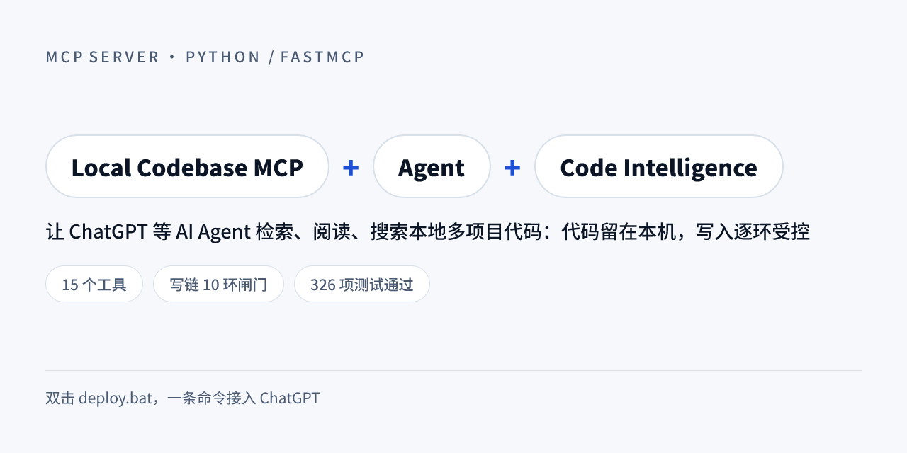

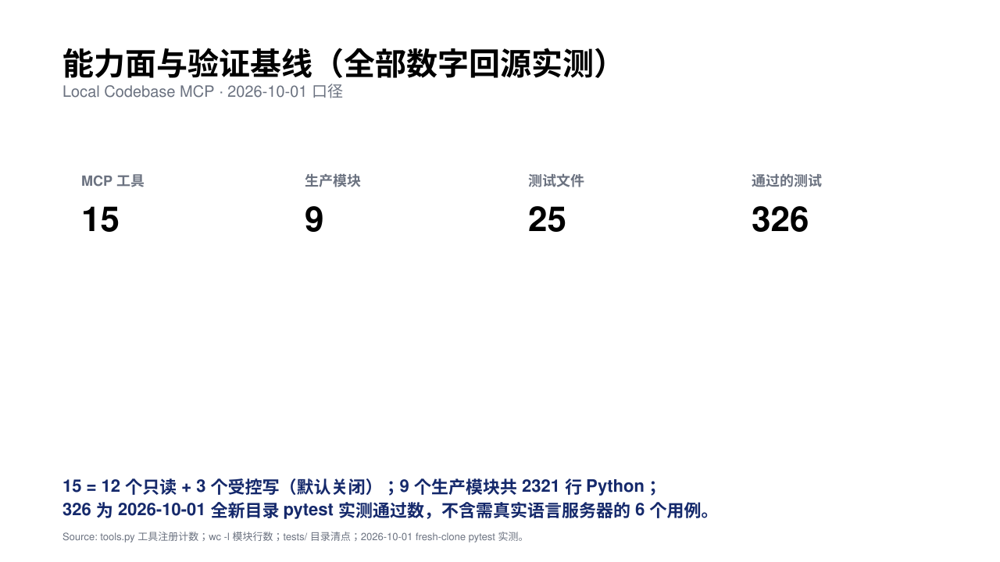

</details>
