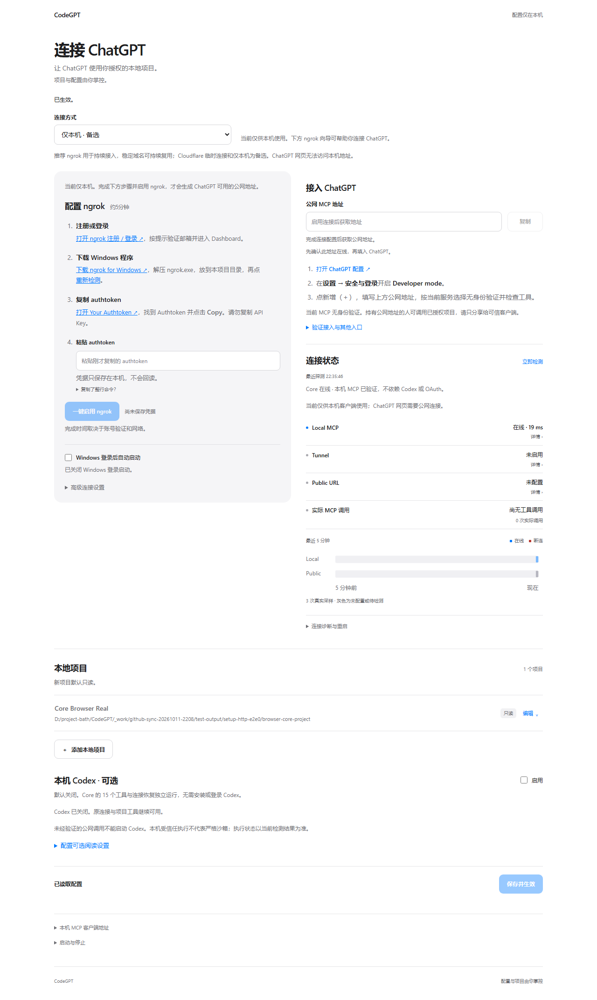

# CodeGPT

让 ChatGPT 按授权阅读、搜索你的本地项目。Python + FastMCP，本机配置页，15 个 MCP 工具。

**当前源码：Core V1.2.0 RC2。** 前端和运行模块同步自受测提交 `55a608cd9b84260d10e9b017a78ab68f02afd8ab`。Agent 默认关闭，不需要安装或登录 Codex；VMware、自研 OAuth 和自动项目阅读继续后置。

[查看最新配置页面](https://shltbro.github.io/CodeGPT/#setup) · [打开交互流程图](https://shltbro.github.io/CodeGPT/diagrams/configuration-workflow.html) · [架构与源码](docs/architecture.md)



## 先在本机使用

1. 下载本仓库 ZIP 或 `git clone https://github.com/SHlTbro/CodeGPT.git`，放到短路径，例如 `D:\CodeGPT`。
2. 安装 Python 3.12+，进入 `local-codebase-mcp`，双击 **setup.bat**。脚本只在项目 `.venv` 安装依赖；浏览器打开本机配置页 `http://127.0.0.1:8169/`。
3. 添加已有文件夹，填写项目名称和唯一 ID，第一次保持只读，点 **保存并生效**。只有后端实际验证后才显示成功。
4. 本机 MCP 客户端使用 `http://127.0.0.1:8168/mcp`。ChatGPT 网页无法直接连接该本机地址。

默认端口被其他实例占用时，先创建单独配置文件，并在其中将 `[server].port` 改为独立端口、`[tunnel].mode` 保持 `"off"`；再运行：

```powershell
cd local-codebase-mcp
.\setup.bat -Config .\config-isolated.toml -Port 18168 -SetupPort 18169 -Tunnel off
```

首次启动前应同时检查配置与 last-good；不要只靠命令行参数禁用旧配置中的公网通道。连接教程、登录启动、停止和错误恢复见 [部署说明](docs/deployment.md)。

## 连接 ChatGPT

在本机页面首部选择连接方式：

- **ngrok：持续使用首选。** 安装 ngrok、注册账号，在本机密码框粘贴 Authtoken，启用并等候真实公网验证。可填写账号分配的固定开发域名；Token 不要发到聊天或提交 Git。
- **Cloudflare 临时连接：免注册备选。** 安装 cloudflared 后启用。临时地址重建会变化，不能视为固定域名恢复。
- **仅本机：本机 MCP 客户端使用。** 不产生可供 ChatGPT 云端访问的地址。

复制页面中包含 `/mcp` 的公网地址，在 [ChatGPT 连接设置](https://chatgpt.com/plugins) 添加自定义 MCP，选中 CodeGPT 后实际调用 `list_projects`。入口受账号/工作区策略影响；以 [OpenAI 官方接入说明](https://developers.openai.com/plugins/deploy/connect-chatgpt) 为准。

**现有公网 MCP 没有用户身份认证。固定 URL、只读权限和 ngrok Authtoken 都不能代替最终用户身份。** 匿名隧道只适用于无敏感合成项目验收；私人代码公网接入需另行限制可信访问。可评估 [OpenAI Secure MCP Tunnel](https://developers.openai.com/api/docs/guides/secure-mcp-tunnels)，账号权限和真实访问限制仍需独立验证。详见 [安全边界](docs/security.md)。

## 保留的核心能力

| 能力 | 实际行为 |
| --- | --- |
| 项目与权限 | 登记目录，默认只读；受控写按项目与目录逐项授权 |
| 配置保存 | 单一 `config.toml`、版本冲突检查、原子写、热加载/受控重启、last-good 恢复 |
| 网络状态 | 分开显示本机 MCP、Tunnel、公网 MCP 和真实调用，近期波动来自探测 |
| 连接恢复 | MCP/Tunnel 意外退出由现有生命周期恢复；固定域名保持相同 URL，额度和客户端问题单列 |
| 版本身份 | 发布构建清单在启动时冻结；源码克隆缺少清单时明确显示 unknown |
| 本机设置 | 开机登录启动默认关闭；停止只处理该实例自己的子进程 |

15 个工具：`list_projects`、`project_info`、`list_files`、`read_file`、`read_batch`、`search_code`、`git_info`、`find_definition`、`find_references`、`workspace_symbols`、`get_diagnostics`、`rename_preview`、`write_file`、`write_binary_file`、`apply_workspace_edit`。后三项写入受项目权限约束；LSP 正向能力需要对应语言服务器和工程上下文，注册工具不等于所有项目均可用。

## 可交互流程图

[配置保存与失败恢复](https://shltbro.github.io/CodeGPT/diagrams/configuration-workflow.html) 在浏览器中直接运行，可点击节点、搜索、聚焦、切换主题和导出。README 中的图片是静态预览；交互请打开网页。也可下载 `site/diagrams/*.html` 后离线打开，无需服务器。

图展示实际配置链路，包含输入拒绝、并发冲突、验证失败、last-good 及人工修复，不用绿色节点代替运行验收。

## 验证与限制

Core RC2 已有独立安装、TOML/last-good、回退和真实 ChatGPT 合成只读证据。固定域名 Tunnel 重启前后原连接恢复已通过；这一结论不代表所有 Wi-Fi、VPN、睡眠或私人公网访问均通过。此次 GitHub 同步不切换现用服务，也不重写既有 RC2 发行 tag/ZIP。

在源码目录安装 `requirements-dev.txt` 后，运行受影响 Core 测试：

```powershell
.\.venv\Scripts\python.exe -m pytest tests/unit/test_config_store.py tests/security/test_setup_secrets.py tests/integration/test_core_setup_browser.py -q
```

浏览器测试需要 Playwright Chromium。更完整的范围、源码来源和恢复步骤见 [验证说明](docs/verification.md)。

## 许可证

[MIT](LICENSE)。第三方组件与流程图生成器见 [第三方声明](THIRD_PARTY_NOTICES.md)。
