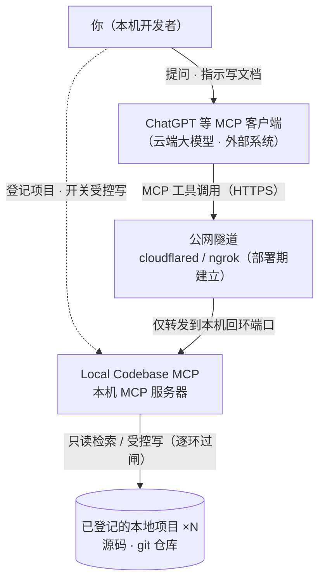
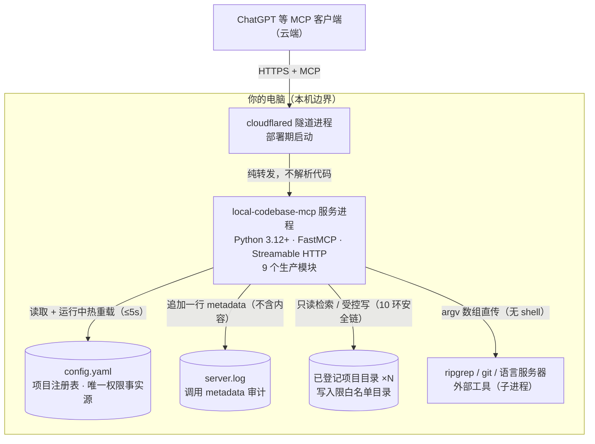

# 架构

> 图事实唯一来源：本轮 F01 取证（源码实读）。节点/边逐项映射见文末表格，无事实的边不画。
> 图源语法：GitHub 原生 Mermaid `flowchart`（C4 语义保留在分层结构与图例中；Mermaid 的 C4 图型在 GitHub 渲染未验证，故不使用）。

## 系统上下文（C4 Level 1）

回答一个问题：谁在跟这个系统打交道。

本机浏览器打不开隧道地址是正常现象：访问发生在云端模型服务侧，服务器只监听回环地址（`127.0.0.1` 等，`0.0.0.0` 会被配置校验直接拒绝）。

## 容器（C4 Level 2）

回答一个问题：本机边界内有哪些可运行单元，数据怎么流。

服务进程内部是 9 个 Python 模块：`server.py`（装配/自检/热重载）、`tools.py`（15 个工具注册）、`tools_services.py`（只读服务实现）、`writer.py`（受控写）、`intel.py`（语言服务器会话）、`security.py`（路径守卫/敏感过滤/预算）、`config.py`（解析校验）、`projects.py`（注册表）、`errors.py`（错误信封）。这层是进程内组件划分，不在图上展开。

## 图例

| 记号 | 含义 |
|---|---|
| 实线箭头 | 运行期调用 / 数据流 |
| 虚线箭头 | 配置流（部署期或运行期配置） |
| 圆柱形 | 数据存储（文件） |
| 矩形 | 进程 / 外部系统 |
| 标注文字 | 关系的技术事实（协议、约束） |

## 节点与边映射表

| 图要素 | 事实锚点（源码） |
|---|---|
| 仅回环监听，`0.0.0.0` 拒绝 | `config.py` 回环白名单与校验；`server.py` 显式绑定 host |
| 隧道三模式与部署期建立 | `deploy.ps1` 隧道模式优先级段；`docs/deployment.md` |
| 15 个工具注册 | `tools.py` 的 `@mcp.tool` 注册段（12 只读 + 3 受控写） |
| 热重载 ≤5s | `server.py` 重载轮询与生效时限常量 |
| 读写路径过闸 | `security.py` PathGuard / 敏感过滤 / 预算；`writer.py` 安全链 |
| argv 直传无 shell | `tools_services.py`、`intel.py` 子进程调用；`tests/security/test_no_shell.py` 静态断言 |
| 日志只记 metadata | `server.py` 模块 docstring；`writer.py` 审计行实例 |
| 9 个生产模块 | 本轮 `wc -l` 实测 2321 行（见 README 成熟度节） |

## 不存在的边（禁边表）

- **ChatGPT → 服务进程（直连）**：不存在。服务只监听回环地址，云端可达性只由隧道提供。
- **隧道 → 项目目录（读代码）**：不存在。隧道是纯转发，不解析、不缓存代码内容。
- **模型 → 文件系统（直读）**：不存在。模型只能经 15 个工具面访问，路径由注册表与 PathGuard 约束。
- **MCP Server → 命令执行 / Agent 规划**：不存在。PRD 明确不做命令执行与 Agent 流程；子进程仅限 ripgrep/git/语言服务器三类工具。
- **写路径绕过安全链**：不存在。写链顺序不可变（registry → write_enabled → 路径解析 → 白名单 → 敏感过滤 → 冲突 → 预算 → 原子写）。
