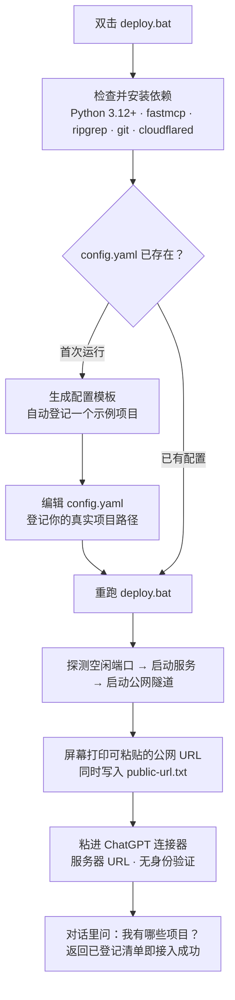
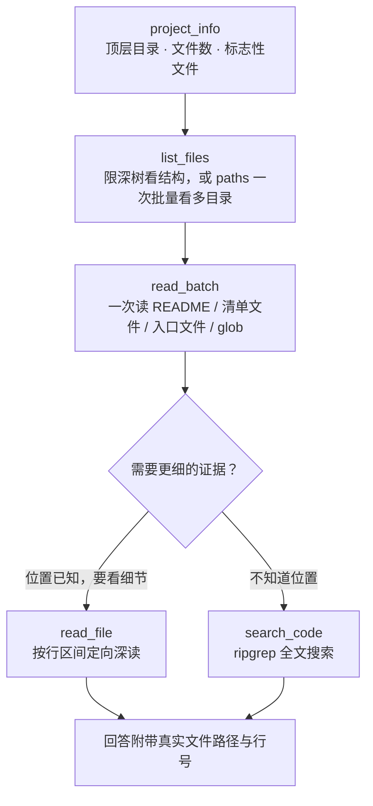
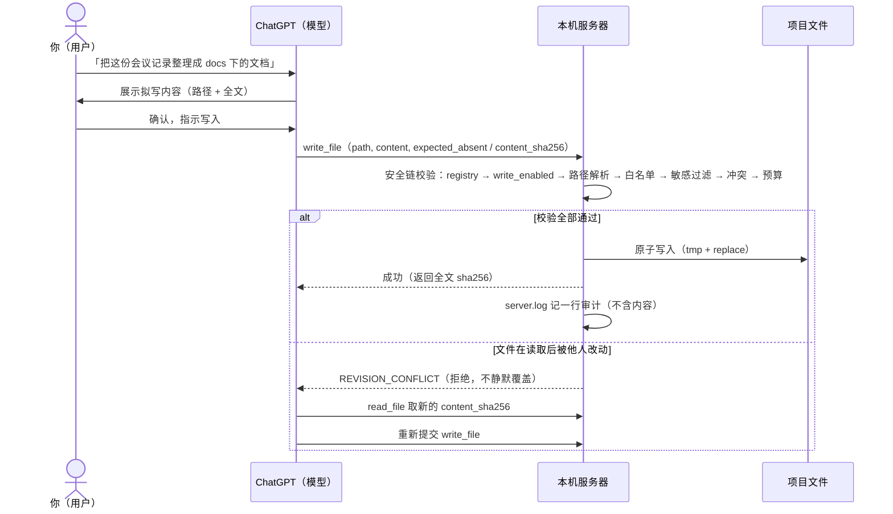

# 核心流程

> 三条链路全部来自真实使用过程：部署接入（deploy 脚本与部署经验文档）、首轮取证（工具说明的推荐调用序列）、受控写回路（写安全链与人机闭环约定）。图源为 GitHub 原生 Mermaid。

## 链路一：接入（部署一次，双击开始）

两个常见疑问：隧道地址每次重启会变（要固定地址用 Cloudflare named 隧道，配置一次终身可用）；本机浏览器打不开隧道地址不影响 ChatGPT 使用，判据看服务端日志有没有外部请求。

## 链路二：首轮取证（每个新项目的第一轮对话）

这四步是服务端推荐的调用序列：第一轮就建立架构认知，避免逐文件多轮往返。批量读取有双层字符预算，内容超限的文件以 `BUDGET_EXHAUSTED` 标注，不会打爆上下文。

## 链路三：受控写回路（默认关闭，逐项目开启）

MCP 协议没有审批弹窗，所以约定的人机闭环是：模型在对话里展示拟写内容，你确认后才指示写入；服务端闸门负责兜底（范围、敏感过滤、哈希冲突、大小预算），审计可查。工作区级重构走两段式：`rename_preview` 先出逐文件编辑计划（只读），`apply_workspace_edit` 应用时全部校验通过才写，任一不匹配整体拒绝、零文件落盘。

## 图与事实的映射

| 图要素 | 事实来源 |
|---|---|
| 部署九步（依赖/模板/端口/隧道/URL） | 一键部署脚本流程与部署经验文档的 v2 流程节 |
| URL 写入 public-url.txt；named 隧道固定地址 | 部署脚本的 URL 抓取与 named 模式分支 |
| 首轮四步调用序列与批量预算 | README「批量取证」节（服务端强制规则） |
| 展示拟写内容 → 用户确认 → 服务端兜底 | README「审批语义」节（人机闭环约定） |
| 10 环安全链与 REVISION_CONFLICT 行为 | `writer.py` 写链实现（顺序不可变）与冲突检查代码 |
| 审计一行不含内容 | `server.py` 日志纪律；`writer.py` 审计行实例 |
